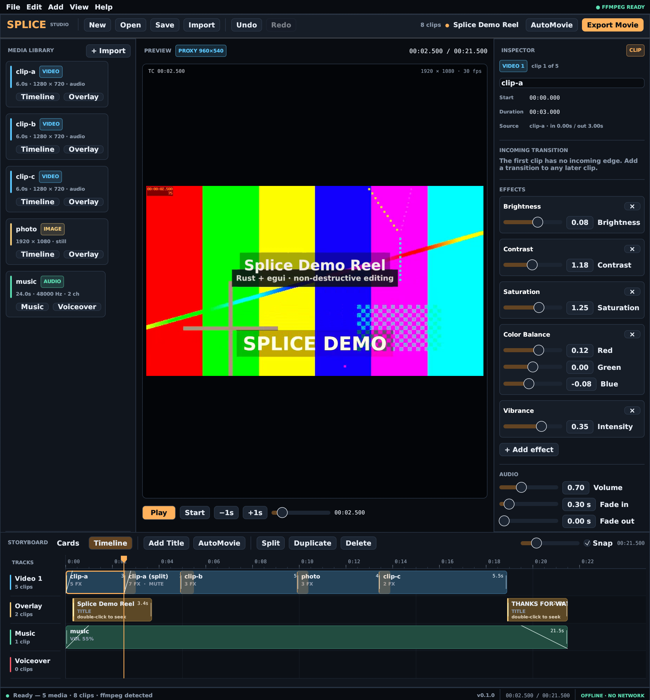

# Splice

Splice is a native Linux timeline video editor written in Rust with egui/eframe.
Editing is non-destructive, preview is rendered through an ffmpeg proxy, and
export is a single deterministic ffmpeg graph shared by the GUI and the CLI.
Splice is fully offline: no network calls, telemetry, uploads or auto-update.



## Features

- Storyboard and multi-track timeline: `Video 1`, `Overlay`, `Music`, `Voiceover`.
- Media library with ffprobe probing, offline detection and validated relinking.
- 58 transitions (the full ffmpeg `xfade` set) and 38 effects covering tone,
  colour, denoise, blur, distortion, pixelation and colour-ramp looks, plus 10
  animated title styles.
- Categorized effect picker with live search, and a searchable transition menu.
- AutoMovie: opening title, scene crossfades, closing credits and an optional
  music bed fitted to the movie length.
- Voiceover recording from the default input through cpal.
- Split, trim, duplicate, reorder, multi-select-free inspector editing, and
  snapshot undo/redo with gesture coalescing.
- Proxy preview (960 × 540) with soundtrack monitoring on the default output.
- Atomic `.splice` saves and a versioned JSON project format.
- Locked H.264/AAC export presets (1080p, 720p, 480p); the same encoder runs
  from the GUI and the CLI.
- Source media is referenced and validated, never copied or rewritten.

## Requirements

- Linux with Wayland or X11 and working OpenGL (eframe/glow).
- Rust 1.85 or newer.
- System `ffmpeg` and `ffprobe` with the `libx264` and `aac` encoders.
- DejaVu fonts for the UI and the default title look. Other installed fonts are
  offered in the title editor.
- A default audio input for voiceover and a default output for preview audio.

Verify the encoder toolchain:

```sh
ffmpeg -hide_banner -encoders | grep -E '^[VAS].* (libx264|aac) '
```

## Build and run

```sh
cargo build --release
./target/release/splice                 # empty project
./target/release/splice movie.splice    # open an existing project
```

Keyboard controls: `Space` play/pause, `Ctrl/Cmd+S` save, `Ctrl/Cmd+O` open,
`Ctrl/Cmd+E` export, `Ctrl/Cmd+Z` undo, `Shift+Ctrl/Cmd+Z` redo, `S` split at
the playhead, `D` duplicate, `Delete` remove the selected clip.

## CLI

```sh
# Export a project. Presets are the only supported encoder settings.
splice export --project docs/demo.splice --preset 1080p --output movie.mp4

# Probe any media file with the system ffprobe.
splice probe docs/media/clip-a.mp4

# Record from the default input and fail if the capture is silent.
splice voicecheck --seconds 4 --output voice.wav
```

Export exits `0` only after a complete, non-empty file has been atomically
renamed into place. Empty timelines, offline media, a non-`.mp4` output path,
or an output that resolves to a source file are refused with a non-zero exit
and no partial output.

For verification screenshots, the GUI can capture its real framebuffer:

```sh
splice docs/demo.splice --playhead 2.5 \
    --screenshot /tmp/splice.png --exit-after-screenshot
```

## Reproducible demo

```sh
bash scripts/demo.sh
```

The script generates every fixture locally with ffmpeg `lavfi` sources (no
network), imports them through the real ffprobe/library path, writes
`docs/demo.splice`, exports `docs/demo.mp4` at 1080p through the CLI, then
captures the running GUI to `docs/screenshot.png`. Set `SKIP_SCREENSHOT=1` on a
headless machine. The output paths can be overridden with `DEMO_MEDIA_DIR`,
`DEMO_PROJECT`, `DEMO_OUTPUT` and `DEMO_SCREENSHOT`.

## Project format and export contract

- [Project format](docs/PROJECT_FORMAT.md) — envelope, media, tracks, clips,
  effects, transitions, titles, save/load guarantees and compatibility policy.
- [Export presets](docs/EXPORT_PRESETS.md) — resolution, encoder settings,
  container, audio, GUI/CLI behaviour and refusal rules.
- [Verification log](docs/VERIFICATION.md) — append-only evidence from the
  machine that built and ran the delivery.

Projects are UTF-8 JSON with the `.splice` extension. Saves write a temporary
file in the destination directory, fsync it, then rename it over the project,
so a crash cannot leave a truncated document. Unknown newer schema versions are
refused rather than guessed.

## Tests

```sh
cargo test
cargo clippy --all-targets -- -D warnings
cargo fmt --check
```

The deterministic suite covers the project round-trip, version refusal, offline
assets and relinking, every transition/effect/title style, AutoMovie, export at
all three presets, CLI blocking, and measured frame/audio properties.

The preview audio path is hardware-backed, so its gates are marked ignored for
headless machines. Run them where a default output exists:

```sh
cargo test --lib audio::tests::audio_monitor_plays_decoded_audio -- --ignored --nocapture
cargo test --lib preview::tests::playback_starts_audio_monitor -- --ignored --nocapture
```

## Source layout

| Path | Responsibility |
| --- | --- |
| `src/model.rs` | Project schema, clips, tracks, titles, invariants |
| `src/project_io.rs` | Atomic save, versioned load, path normalization, validation |
| `src/library.rs` | ffprobe import and validated relink |
| `src/edit.rs` | Split, trim, duplicate, reorder and storyboard reflow |
| `src/history.rs` | Snapshot undo/redo with gesture coalescing |
| `src/render.rs` | One ffmpeg filter graph for preview and export |
| `src/preview.rs` | Proxy rendering, frame decode, playback and audio monitoring |
| `src/audio.rs` | cpal voiceover capture and preview output monitoring |
| `src/titles.rs` | ASS title rendering shared by preview and export |
| `src/timeline_ui.rs` | Storyboard and timeline interaction/painting |
| `src/app.rs` | Editor shell, dialogs, shortcuts and panels |
| `src/main.rs` | CLI entry point |

## Limitations

- Export presets are locked by contract; there is no custom resolution, frame
  rate, codec or bitrate UI.
- Preview is a 960 × 540 proxy and is re-rendered shortly after edits. Preview
  audio and video follow the same wall clock, so a seek restarts monitoring.
- System ffmpeg/ffprobe are required; no encoder is bundled.
- Titles are rendered through libass, so fonts must be installed on the host.
