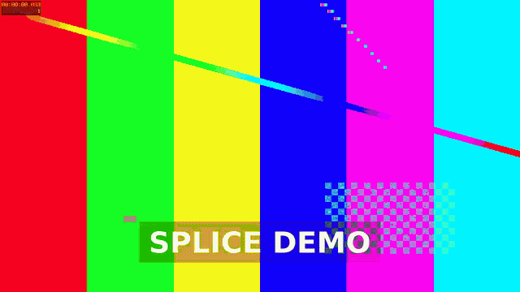

# Splice

[](https://github.com/GeneticxCln/Splice/actions/workflows/ci.yml) [](https://github.com/GeneticxCln/Splice/actions/workflows/msrv.yml) [](https://github.com/GeneticxCln/Splice/releases)

Splice is a Linux timeline video editor written in Rust with egui/eframe. It
uses system ffmpeg for media probing, proxy preview, and H.264/AAC export.
Projects are versioned JSON documents with the `.splice` extension.



*The 21.5-second demo reel exercises transitions, effects, titles, and audio.*

## Features

- Storyboard and four-track timeline: Video 1, Overlay, Music, Voiceover.
- 58 transitions, 38 effects, and 10 title styles with optional custom motion.
- Clip-local scale, pan, rotation, and opacity keyframes with timeline markers.
- Searchable effect and transition menus.
- AutoMovie titles, crossfades, credits, and optional music.
- Proxy preview with audio monitoring; output recovers after device errors.
- Voiceover recording, media relinking, and offline-media validation.
- Atomic saves, autosave with crash recovery, and a versioned project format.
- Export progress with cancel; a prompt before unsaved changes are discarded.
- Picture-in-picture overlays (size and position), and clips can move between
  compatible tracks.
- Long timelines preview one 30 s slice at a time, so previews stay fast.
- Native file choosers through `zenity` or `kdialog` when installed.
- Landscape and 9:16 Shorts presets for YouTube Shorts and TikTok.
- 1080p, 720p, and 480p H.264/AAC presets shared by the GUI and CLI.
- Shorts mode with fill/fit framing, safe-area guides, and automatic title
  wrapping/clamping.

## Requirements

- Linux with Wayland or X11 and OpenGL.
- Rust 1.88 or newer.
- System `ffmpeg` and `ffprobe` with the `libx264` and `aac` encoders.
- DejaVu fonts for the default UI and title look. Other installed fonts can be
  selected.
- A default audio input and output for voiceover and preview monitoring.

## Install

```sh
cargo build --release
packaging/install.sh                # ~/.local, or PREFIX=/usr/local sudo packaging/install.sh
```

This installs the binary, a desktop entry, an icon and the `.splice` MIME type.

## Build and run

```sh
cargo build --release
./target/release/splice                 # new project
./target/release/splice movie.splice    # open a project
```

Keyboard: `Space` play/pause, `Ctrl+S` save, `Ctrl+O` open, `Ctrl+E` export,
`Ctrl+Z`/`Ctrl+Shift+Z` undo/redo, `S` split, `D` duplicate, `Delete` remove.

## CLI

```sh
splice export --project docs/demo.splice --preset 1080p --output movie.mp4
splice export --project docs/demo.splice --preset shorts-1080p --output short.mp4
splice probe docs/media/clip-a.mp4
splice voicecheck --seconds 4 --output voice.wav
```

Export returns `0` only after a complete file is written. Missing media, empty
timelines, invalid output paths, and source-overwrite attempts fail without
partial output.

## Known limitations

- Frame rate (30 fps) and audio (48 kHz stereo) are fixed; `settings.fps` and
  `settings.sample_rate` are stored but not applied.
- Every edit re-renders the preview (the whole timeline up to 60 s, otherwise
  one 30 s slice). Where a slice cuts a clip, fades and transitions that
  straddle the cut and clip-length effects such as Pan & Zoom restart in the
  preview; export is unaffected.
- Without `zenity` or `kdialog` the file dialogs are typed paths.
- A project that has never been saved is not autosaved.
- Linux only, x86_64 release builds.

## Demo

```sh
bash scripts/demo.sh
```

This creates local ffmpeg fixtures, imports them through the library, writes
`docs/demo.splice`, exports `docs/demo.mp4`, encodes the README's `docs/demo.gif`,
and captures `docs/screenshot.png`. Set `SKIP_SCREENSHOT=1` on a headless
machine.

## Tests

```sh
cargo test
cargo clippy --all-targets -- -D warnings
cargo fmt --check
bash scripts/check-msrv.sh   # requires rustup and Rust 1.88.0
cargo test --release --test scale -- --ignored --nocapture   # 10 minute, 120 clip project
```

Audio tests marked ignored require a default output device.

## Documentation

- [Project format](docs/PROJECT_FORMAT.md)
- [Export presets](docs/EXPORT_PRESETS.md)
- [Verification log](docs/VERIFICATION.md)
- [Changelog](CHANGELOG.md)

## License

MIT. See [LICENSE](LICENSE).
